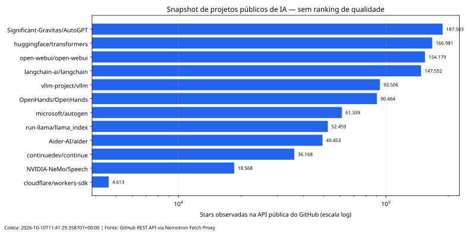

# Nemotron Mobile + Fetch Proxy

> **Projeto de portfólio em dados, IA aplicada e engenharia de software:** um aplicativo Android/WebView que permite conversar com modelos compatíveis com a API OpenAI, explorar um repositório GitHub sob demanda e propor alterações com revisão por diff, apoiado por um proxy serverless para leitura segura de URLs.


## Por que este projeto importa

Recrutadores conseguem avaliar, em poucos minutos, três competências demonstradas aqui:

1. **Integração com dados externos:** leitura incremental de árvores e arquivos de repositórios GitHub, sem baixar todo o projeto de uma vez.
2. **Aplicação prática de LLMs:** streaming de respostas, tool calling, contexto de arquivos, suporte opcional a visão e fallback entre provedores compatíveis com OpenAI.
3. **Engenharia responsável:** propostas de edição exibidas como diff antes de qualquer alteração, limites de tamanho, tratamento de erros e proteção SSRF no proxy.

## Arquitetura

```text
┌─────────────────────────────┐
│ Android WebView             │
│ Nemotron Mobile             │
│ chat + contexto + diff      │
└──────────────┬──────────────┘
               │ HTTPS
     ┌─────────┴─────────┐
     │                   │
┌────▼─────┐       ┌─────▼──────────┐
│ Provedor │       │ GitHub API /   │
│ LLM      │       │ raw content    │
└──────────┘       └────────────────┘
               │
        ┌──────▼─────────────┐
        │ Cloudflare Worker  │
        │ /api/fetch         │
        │ SSRF + stream +    │
        │ HTML→texto + rate  │
        └────────────────────┘
```

## Componentes

### Cliente Nemotron Mobile

O APK analisado contém uma interface web single-file em `assets/index.html`, empacotada em um WebView Android. O cliente oferece:

- conversa com endpoints `/chat/completions` compatíveis com OpenAI;
- respostas em streaming via Server-Sent Events;
- configuração de múltiplos provedores e fallback;
- contexto lazy de repositórios públicos do GitHub;
- upload de arquivos de texto e imagens;
- ferramentas `list_files`, `read_file`, `search_code`, `fetch_url` e `propose_edit`;
- revisão visual de diff antes de copiar ou commitar uma alteração;
- commit opcional pelo GitHub Contents API.

### Fetch Proxy

O Worker fornece:

```text
GET /api/health
GET /api/fetch?url=<url>&format=text|links&maxChars=20000
```

O proxy foi desenhado para reduzir riscos de SSRF e abuso:

- redirects seguidos manualmente, com revalidação a cada salto;
- bloqueio de faixas privadas, reservadas, loopback, CGNAT e multicast;
- somente portas 80 e 443;
- bloqueio de credenciais embutidas na URL;
- leitura em stream com teto de 2 MB e timeout cobrindo o corpo;
- extração HTML→texto com `HTMLRewriter`;
- rate limit por isolate;
- CORS configurável por `ALLOWED_ORIGINS`;
- testes no runtime real do Workers.

O setup de testes usa `@cloudflare/vitest-pool-workers` e carrega o
`wrangler.jsonc` como configuração do runtime. A configuração final compatível
com a versão atual do pool é:

```ts
import { defineWorkersConfig } from "@cloudflare/vitest-pool-workers/config";

export default defineWorkersConfig({
  test: {
    include: ["test/**/*.test.ts"],
    pool: "@cloudflare/vitest-pool-workers",
    poolOptions: { workers: { wrangler: { configPath: "./wrangler.jsonc" } } },
  },
});
```

Isso é uma evidência melhor do que executar testes apenas em Node, porque os
testes exercitam APIs e bindings no ambiente compatível com Cloudflare Workers.

A configuração Wrangler recebida confirma o entrypoint `src/index.ts`, o nome
do Worker `nemotron-fetch-proxy`, `nodejs_compat` e observabilidade habilitada
com amostragem de 100%. Não há bindings externos declarados nessa configuração;
o rate limit descrito no README, portanto, permanece em memória por isolate.

## Como executar o Worker

> O código do Worker precisa estar no repositório para que estes comandos sejam reproduzíveis. O README original informa que ele usa npm, Wrangler e testes no runtime Workers.

```bash
npm install
npm test
npm run typecheck
npx wrangler dev
```

O `wrangler.jsonc` deve ficar na raiz do componente `workers/fetch-proxy/` e
apontar para `src/index.ts`.

Verificação local:

```bash
curl http://localhost:8787/api/health
curl 'http://localhost:8787/api/fetch?url=https%3A%2F%2Fexample.com&format=text'
```

Publicação:

```bash
npx wrangler deploy
```

Após o deploy, configure a URL do Worker na constante `FETCH_PROXY` do cliente e gere novamente o APK.

Para uma avaliação rápida, siga o [quickstart para recrutadores](docs/QUICKSTART_RECRUITER.md). As decisões de tools, contexto lazy e revisão de diff estão no [contrato de tools](docs/TOOL_CONTRACT.md). O [benchmark de projetos alinhados](docs/BENCHMARK.md) explica por que o repositório prioriza um fluxo vertical pequeno em vez de copiar plataformas maiores.

### Validação com dados públicos reais

O framework foi executado localmente contra fontes públicas reais do GitHub, Cloudflare Developers e Example Domain, sem tokens. A rodada validou HTTP 200, parsing de texto/JSON, limite de saída e marcadores semânticos; também bloqueou loopback, IP privado, credenciais na URL, porta não permitida e formato inválido. O relatório reproduzível está em [docs/REAL_DATA_VALIDATION.md](docs/REAL_DATA_VALIDATION.md), com dados brutos em [`REAL_DATA_VALIDATION.json`](docs/REAL_DATA_VALIDATION.json) e o script em [`scripts/real_data_validation.py`](scripts/real_data_validation.py).

Resultado observado em 10/10/2026: **11 cenários executados**, fontes públicas retornando upstream HTTP 200 e cinco entradas perigosas/inválidas rejeitadas com HTTP 400. O tempo local observado ficou entre aproximadamente **93 ms e 1.318 ms** por requisição; isso é uma medição daquela execução, não uma garantia de produção.

### Camada analítica com dados reais

Para aproximar o projeto de vagas de dados/IA, foi adicionada uma coleta reproduzível de metadados públicos de **12 repositórios de IA** pela API REST do GitHub, sempre passando pelo próprio Fetch Proxy. O snapshot registrou **12/12 respostas bem-sucedidas**, **0 falhas**, latência observada de **31,0 ms a 460,7 ms** e mediana observada de **169,55 ms** nesta execução local. Uma entrada foi explicitamente canonicalizada pela API: `NVIDIA/NeMo` retornou `NVIDIA-NeMo/Speech`; isso permanece registrado como redirecionamento, não é tratado como se fosse o mesmo repositório.

O dataset versionado está em [`data/ai_repositories_snapshot.csv`](data/ai_repositories_snapshot.csv) e [`data/ai_repositories_snapshot.json`](data/ai_repositories_snapshot.json). O relatório com método e limitações está em [`docs/AI_REPOSITORIES_SNAPSHOT.md`](docs/AI_REPOSITORIES_SNAPSHOT.md), e o gráfico mostra somente stars observadas — não um ranking de qualidade:



Para reproduzir a coleta e a visualização, com o Worker local rodando:

```bash
python3 scripts/collect_ai_repositories.py
python3 scripts/plot_ai_repositories.py
```

Os números são snapshots públicos e mutáveis. Eles não representam qualidade, popularidade futura, performance de modelo ou probabilidade de contratação. Não há deployment público do Worker nesta entrega; a execução demonstrada é local e essa limitação permanece explícita.

## Como avaliar o cliente

O APK de referência está em [`recovered-app/NemotronMobile.apk`](recovered-app/NemotronMobile.apk). Para uma avaliação completa, o repositório deve incluir o projeto-fonte Android/WebView e um provedor compatível com OpenAI configurado localmente pelo avaliador.

Fluxo demonstrável:

1. abrir o aplicativo;
2. cadastrar um endpoint/modelo e uma chave de teste;
3. carregar um repositório público, por exemplo `owner/repository`;
4. pedir uma explicação de um arquivo;
5. pedir uma melhoria pequena;
6. revisar o diff;
7. descartar a proposta ou copiá-la para aplicação manual.

**Nunca commite chaves de API ou tokens do GitHub no repositório.** Para uma versão pública, prefira secrets do ambiente, um backend intermediário e tokens de escopo mínimo.

## Decisões técnicas que merecem atenção

- **Lazy loading:** reduz contexto enviado ao modelo e custo por solicitação.
- **Human-in-the-loop:** o modelo pode propor, mas não aplica edição sem ação explícita do usuário.
- **Fallback de provedores:** melhora resiliência diante de limites ou falhas de CORS.
- **Proxy serverless:** centraliza proteção, parsing e controle de tamanho para URLs externas.

## Próximas melhorias priorizadas

### P0 — necessário para publicação

- adicionar o projeto Android/WebView original, com instruções de build;
- remover tokens do `localStorage` ou documentar claramente o risco e migrar para backend seguro;
- adicionar política de privacidade e aviso de que conteúdo externo pode conter prompt injection;
- configurar build automatizado do cliente Android.

### P1 — diferenciação para vagas de dados/IA

- adicionar telemetria local opt-in: latência, tokens, erro por provedor e tamanho de contexto;
- criar uma tela ou notebook de avaliação com perguntas fixas e métricas de qualidade;
- registrar custo estimado, tempo até primeiro token e taxa de fallback;
- incluir uma tabela de resultados e limitações no README;
- adicionar dataset sintético de repositórios para testes determinísticos.

### P2 — produto e segurança

- trocar commit direto no GitHub por criação de branch/PR;
- usar backend para intermediar credenciais e evitar exposição de tokens no cliente;
- adicionar CSP, política de permissões e pinning/configuração explícita de domínios;
- usar Durable Objects ou binding de Rate Limiting se o limite global for necessário.

## Estado desta entrega

Esta pasta contém uma implementação funcional reconstruída do Worker a partir
da especificação recebida, com `src/index.ts`, `package.json`, `wrangler.jsonc`,
`vitest.config.ts`, 16 testes, CI e documentação de segurança. A validação local
foi concluída com `npm run typecheck` e `npm test` — **16 testes passando no
runtime Cloudflare**.

O APK continua sendo um artefato compilado; o projeto Android/WebView original
e o código-fonte original do Worker não foram enviados. A pasta
`recovered-app/` preserva o APK e a interface web extraída como referência.
