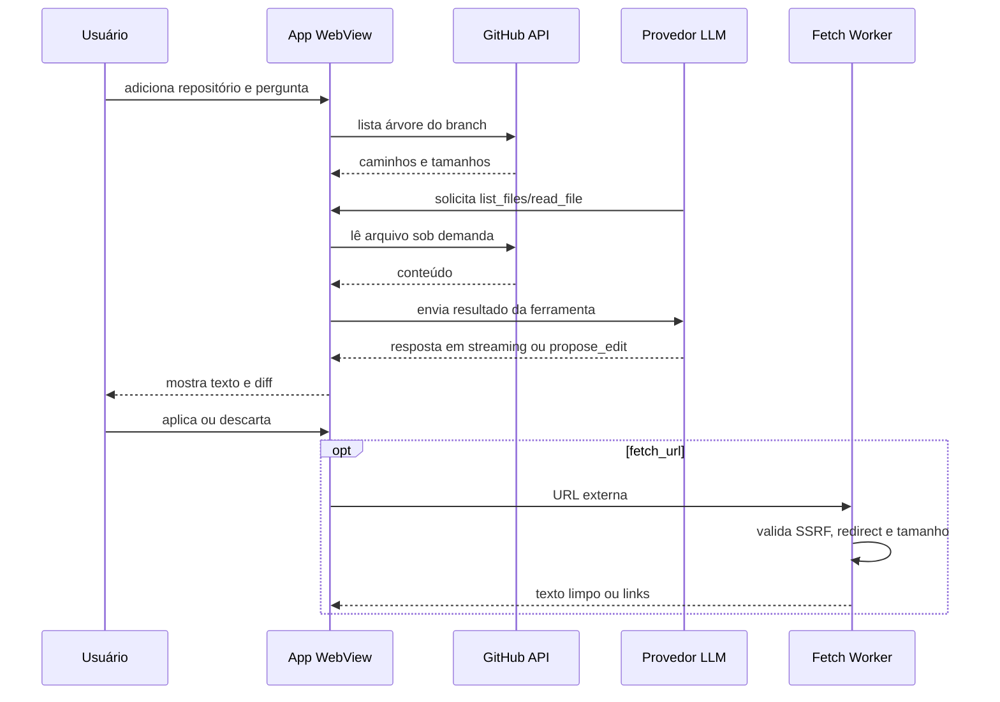

# Arquitetura observada

## Fluxo principal

## Limites atuais

- o APK é WebView; não há banco de dados local próprio identificado;
- estado de provedores e token GitHub usa `localStorage`;
- o índice de arquivos é mantido em memória durante a sessão;
- conteúdo de arquivos é carregado e cacheado conforme o modelo pede;
- a escrita é direta no GitHub Contents API ou cópia para clipboard;
- o proxy não renderiza JavaScript de SPAs.

## Telemetria recomendada

Para reforçar o foco em dados, adicionar eventos locais ou opt-in:

| Evento | Campos | Métrica derivada |
|---|---|---|
| `request_started` | provider, model, has_image, file_count | volume por cenário |
| `first_token` | elapsed_ms | time-to-first-token |
| `request_finished` | elapsed_ms, chars_in, chars_out | latência e tamanho |
| `provider_failed` | provider, status | taxa de falha |
| `fallback_used` | from, to | resiliência |
| `tool_called` | tool, result_chars | uso de contexto |
| `edit_reviewed` | action, lines_added, lines_removed | adoção de proposta |

Não registrar prompts, tokens, chaves ou conteúdo privado por padrão.
